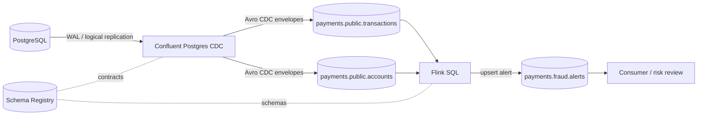

# Pipeline de Pagamentos em Tempo Real com Confluent Cloud


**Bootcamp IBM Confluent — Dados em tempo real para agentes de IA**

> **Estado da entrega:** implementação e roteiro prontos. Os blocos de `evidence/` contêm instruções e modelos; **não afirmam** que recursos cloud foram provisionados. Nenhuma métrica de latência, taxa de alerta ou custo é apresentada aqui sem ter sido medida em uma execução real.

---

## Visão geral

Pipeline de referência que captura transações de um PostgreSQL por **CDC**, valida contratos **Avro** no Schema Registry, enriquece e analisa o fluxo com **Flink SQL** no Confluent Cloud e publica um **alerta de risco** quando um mesmo cartão faz **3 ou mais transações em 60 segundos**.

O foco não é "usar Kafka e Flink", e sim resolver um problema: **sinalizar pagamentos suspeitos enquanto ainda dá tempo de revisá-los**, com decisões de engenharia justificadas e passos reproduzíveis.

## Objetivo do projeto

Montar, camada por camada, um pipeline de pagamentos em streaming e documentar cada decisão, trade-off e ponto de operação (segurança, custo e teardown). O projeto foi construído no bootcamp para praticar cinco camadas: fundação, contrato, ingestão, processamento e operação.

---

## 1. Problema de negócio

Pagamentos suspeitos precisam ser detectados enquanto ainda podem ser revisados. Processamento em lote aumenta a latência entre a atividade do cartão e a sinalização. Este projeto entrega um evento de alerta quando um cartão apresenta três ou mais transações em uma janela de 60 segundos, já enriquecido com dados da conta (`risk_tier`).

## 2. Contexto e baseline

- **Contexto:** o domínio usa dados sintéticos determinísticos, sem dados pessoais reais.
- **Baseline:** hoje não há detecção contínua. Cada evento é avaliado individualmente e não existe alerta por frequência em janela.
- **O que a solução precisa superar:** a ausência de alerta por frequência. A comparação numérica (latência antes x depois, redução de fraude) **só é possível com medição no ambiente do operador**; este repositório não alega nenhum ganho medido.

## 3. Premissas

- O PostgreSQL é a fonte da verdade; `transactions` tem chave primária estável e `updated_at`.
- O Debezium publica eventos CDC com envelope (`before`/`after`/`op`) e tombstones Kafka para exclusões.
- O conector gerenciado precisa **alcançar o PostgreSQL pela rede** (banco gerenciado com TLS e replicação lógica). Ele não acessa o `localhost` da sua máquina.
- `amount_minor` é armazenado em centavos inteiros (BIGINT) e convertido para decimal na camada analítica.
- A regra é uma **heurística de triagem**, não uma decisão automática de fraude. A janela é calculada por cartão.
- Custos e disponibilidade dependem de região, tier, retenção e tempo de execução na conta Confluent.

---

## 4. Planejamento da solução

### Arquitetura



### Camadas

| Camada | Componente | Responsabilidade |
|---|---|---|
| 1. Fundação | Confluent Cloud, ambiente/cluster, service accounts e ACLs (Terraform) | Identidades de escrita/leitura com privilégio mínimo |
| 2. Contrato | Schema Registry + Avro | Evolução compatível e campos sensíveis minimizados |
| 3. Ingestão | PostgreSQL + Debezium CDC (`PostgresCdcSourceV2`) | Capturar insert/update/delete sem polling |
| 4. Processamento | Flink SQL | Desembrulhar CDC, enriquecer e detectar frequência |
| 5. Operação | Métricas, auditoria de ACLs, billing e runbook | Observar, proteger, estimar custo e encerrar recursos |

### Tecnologias

- Confluent Cloud (Kafka, Schema Registry, Flink SQL, conector gerenciado)
- PostgreSQL com `wal_level=logical` e `pgoutput`
- Avro como formato de contrato
- Terraform (provider `confluentinc/confluent ~> 2.0`)
- PowerShell 7 e Confluent CLI para scripts e operação

### Decisões técnicas e trade-offs

| Decisão | Por quê | Trade-off aceito |
|---|---|---|
| **CDC em vez de polling** | Lê o log de transações, preserva a semântica de insert/update/delete e evita consultas repetidas à origem | Exige replicação lógica, slot ativo e monitoramento de WAL |
| **Avro + Schema Registry** | Contratos evolutivos verificáveis e payloads tipados, sem PAN/CVV | Exige disciplina de compatibilidade (`BACKWARD`) |
| **Flink SQL** | Expressa agregação temporal e enriquecimento em SQL, com estado e checkpoints | A semântica de janela e late events precisa ser validada com dados controlados |
| **Janela `HOP` de 1 s com tamanho de 60 s** | Detecção contínua em janelas deslizantes | Um mesmo episódio gera alertas em janelas adjacentes (ver Limitações) |
| **Chave estável (`alert_id`) e sink upsert** | Atualizações de uma janela ativa corrigem o alerta sem duplicá-lo | O consumidor precisa ser idempotente |
| **Service accounts separadas** (conector, Flink, consumidor) | Privilégio mínimo por identidade | Mais ACLs para manter e revisar |
| **Terraform** | Infraestrutura reproduzível e destruível | O state contém segredos e exige backend remoto criptografado |

---

## 5. Limpeza e qualidade dos dados

- O seed usa dados sintéticos com IDs fixos e timestamps relativos ao instante da carga.
- O schema aplica PK, FK, `NOT NULL`, moeda ISO e valores positivos (`amount_minor > 0`), além de `CHECK` para `status`, `risk_tier` e demais domínios.
- `ALTER TABLE transactions REPLICA IDENTITY FULL` garante que o Debezium inclua a linha anterior (`before`) em UPDATE/DELETE.
- No stream, mensagens inválidas ou sem os campos necessários são excluídas das regras e contabilizadas no monitoramento. Elas **não** são reinterpretadas silenciosamente.
- O CDC mantém `before`/`after` para auditoria, e o pipeline trata `op=d` e tombstones conforme a semântica de deleção.

## 6. EDA e validação de hipóteses

Antes de ativar os alertas, rode [`sql/validation.sql`](sql/validation.sql) na origem: volume e distribuição de valor por `status`/`currency` e candidatos a velocidade por cartão.

**Hipótese testada pelo streaming:** "três pagamentos autorizados do mesmo cartão em 60 segundos merecem revisão."

Ela **não** demonstra causalidade e **não** estima precisão/recall. Isso exigiria rótulos de fraude e avaliação offline.

## 7. Preparação de dados e contrato

- Os schemas Avro de exemplo estão em [`schemas/`](schemas/): `payments-value.avsc`, `payments-value-breaking.avsc` e `fraud-alert-value.avsc`.
- O conector registra automaticamente o envelope CDC Debezium. O schema normalizado `payments-value.avsc` serve **apenas** para o exercício isolado de compatibilidade, num subject de laboratório.
- Teste esperado: `payments-value.avsc` contra si mesmo retorna `is_compatible: true`. `payments-value-breaking.avsc` (remove `transaction_id`) retorna `false`.
- `card_id` é sintético/tokenizado e `amount_minor` representa a menor unidade monetária. Um sistema multimoeda deve carregar a escala ISO 4217 explicitamente.
- Detalhes e comandos em [`schemas/README.md`](schemas/README.md).

## 8. Regra de processamento (no lugar de treinamento de modelo)

Este projeto não treina modelo. A "inteligência" é uma regra determinística em Flink SQL ([`sql/10_alert_sink.sql`](sql/10_alert_sink.sql)):

- agrega por `card_id`/`account_id` em janela `HOP` (passo de 1 s, tamanho de 60 s), considerando só `status = 'authorized'`;
- emite alerta quando `COUNT(*) >= 3`;
- enriquece com `risk_tier` da conta via `LEFT JOIN` (`'unknown'` quando não encontrada);
- publica em `payments.fraud.alerts` com `rule_id = 'CARD_VELOCITY_3_IN_60S'`.

O `transaction_ts` é o timestamp de evento e o watermark tolera 5 segundos de atraso.

## 9. Performance técnica

Métricas a coletar na execução real (**ainda não medidas**):

- latência ponta a ponta (transação no Postgres até o alerta no tópico);
- lag do consumidor e do conector;
- erros de task, estado e idade dos statements Flink;
- checkpoints concluídos e restart count.

## 10. Business performance

Converta o erro da regra em impacto financeiro, com variáveis validadas pela área de risco:

```
custo do risco residual = volume revisado × taxa de falso negativo × perda média por incidente
```

Nenhuma variável tem valor fictício neste repositório. Sem rótulos de fraude, a taxa de falso negativo não pode ser estimada.

## 11. Operação e storytelling

- **Operação:** checklist em [`scripts/ops-check.ps1`](scripts/ops-check.ps1) e runbook em [`docs/operations.md`](docs/operations.md) (observabilidade, segurança, custos, confiabilidade e resposta a falhas).
- **Storytelling:** o dado nasce como uma linha no Postgres, vira evento CDC, é enriquecido e agregado no Flink e chega como alerta de triagem a quem faz a revisão. Cada etapa pode ser provada com evidência em `evidence/`.

---

## Insights de engenharia

- O conector gerenciado **não** alcança `localhost`. A prova local vale para validar o Postgres e o seed, mas o CDC exige um endpoint acessível.
- Delete no Debezium é um evento `d` **seguido de um tombstone**. O consumidor precisa tratar os dois.
- Sem chave primária declarada na tabela de origem do Flink, UPDATE/DELETE do CDC não atualiza o estado da agregação.
- Com sink upsert, a idempotência do consumidor não é opcional.
- `publication.autocreate.mode=disabled` exige que a publicação exista antes do conector ([`postgres/publication.sql`](postgres/publication.sql)).

---

## Estrutura do repositório

```
.
├── connectors/      # modelo do conector PostgresCdcSourceV2 e README
├── docs/            # arquitetura, operação/runbook e referências
├── evidence/        # checklist de evidências reais (captures/ ignorada pelo Git)
├── infra/terraform/ # ambiente, cluster, service accounts, API keys e ACLs
├── postgres/        # init/ (schema e seed), publication.sql, test_cdc.sql
├── schemas/         # contratos Avro e guia de compatibilidade
├── scripts/         # setup, render do conector, Schema Registry e ops-check
├── sql/             # statements Flink (fontes, sink de alertas) e validação
├── .env.example
└── LICENSE
```

## Como executar

**Pré-requisitos:** conta Confluent Cloud com permissão para criar recursos, Terraform `>= 1.6`, Confluent CLI, PowerShell 7, PostgreSQL gerenciado acessível pelo conector (TLS e replicação lógica) e Schema Registry e Flink disponíveis na região escolhida.

1. Copie `.env.example` para `.env` e preencha localmente. Nunca versione o `.env`.
2. Crie o banco PostgreSQL com replicação lógica e TLS. Aplique `postgres/init/001_schema.sql` e `002_seed.sql` com `psql`, depois `postgres/publication.sql` como dono do banco.
3. Em `infra/terraform/`, copie `terraform.tfvars.example` para `terraform.tfvars`, rode `terraform init` e `terraform plan`, revise o plano e aplique (ou use `scripts/setup.ps1`, adicionando `-Apply` para criar). Guarde state e outputs sensíveis fora do Git.
4. Valide os contratos com `scripts/schema-registry.ps1` (ações `check`, `compatibility` e `register`), seguindo `schemas/README.md`.
5. Renderize o JSON do conector com `scripts/render_connector.ps1` (o arquivo gerado é ignorado pelo Git e contém segredos) e crie o conector. Confirme o status e os eventos `c`/`u`/`d`.
6. Confirme que o conector criou os tópicos CDC e execute `sql/00_sources.sql` e `sql/10_alert_sink.sql` no workspace Flink, na ordem de [`sql/README.md`](sql/README.md). Ajuste os nomes de tabela ao que o `SHOW TABLES` exibir.
7. Gere três transações autorizadas no mesmo cartão em menos de 60 s. Capture o alerta do tópico `payments.fraud.alerts` e as métricas reais em `evidence/`.
8. Para validar o ciclo CDC sem mexer no seed, execute [`postgres/test_cdc.sql`](postgres/test_cdc.sql) com o conector ativo e capture cada evento antes da remoção.

> Propriedades do conector e comandos específicos do provider de PostgreSQL variam por versão. Confira a documentação da versão disponível no seu ambiente (veja [`docs/references.md`](docs/references.md)).

## Evidências de execução

Use o checklist de [`evidence/README.md`](evidence/README.md) para coletar comandos, eventos e métricas **reais**, sanitizados. A pasta não contém evidências simuladas. Antes da submissão final, anexe capturas de:

- [ ] ambiente, cluster e ACLs
- [ ] compatibilidade no Schema Registry (positivo e negativo)
- [ ] eventos CDC insert, update (`before`/`after`) e delete + tombstone
- [ ] statement Flink em RUNNING, alerta e as três transações que o dispararam
- [ ] métricas de operação (throughput, lag, erros, checkpoints)
- [ ] billing (valor, período, moeda, créditos)
- [ ] teardown com listagem final sem recursos

## Segurança e privacidade

- Segredos só em variáveis locais ou secret manager. `.env`, state e arquivos renderizados estão no `.gitignore`.
- Service accounts separadas por conector, Flink e consumidor, com ACLs limitadas a tópicos e grupos necessários.
- TLS `verify-full` para o PostgreSQL e usuário CDC dedicado. Evite allowlist de IP aberta e monitore slots inativos (crescimento de WAL).
- Dados sintéticos: não use PAN, CVV nem dados pessoais reais.
- Faça rotação e revogação das chaves após o laboratório.

## Custos e teardown

Não há preço fixo confiável sem região, plano, throughput e duração. Registre o custo observado no Billing (intervalo, moeda, componentes e créditos).

Para encerrar: pare os statements Flink, pause e delete o conector, remova as credenciais do laboratório e rode `terraform destroy` em `infra/terraform/`. Confirme no console que cluster, ACLs, service accounts, conector e statements sumiram. O banco de origem criado para o lab deve ser destruído separadamente. A janela de billing pode refletir uso anterior após o teardown.

## Aprendizados

- **O mais difícil:** alinhar a semântica do CDC (envelope, tombstone, `REPLICA IDENTITY`) com o changelog do Flink. A saída é validar com dados controlados antes de confiar na regra.
- **O que faria diferente:** definir desde o início a política de supressão de alertas por episódio e a DLQ, em vez de deixá-las como pendências.
- **Princípio adotado:** nenhuma evidência, métrica ou custo é escrito sem execução real. Um README que declara o que **não** foi medido é mais confiável do que um com números inventados.

## Limitações conhecidas

- A janela `HOP` de 1 s gera alertas em janelas adjacentes para o mesmo episódio (a chave `alert_id` é cartão + início da janela). Para um único alerta por episódio, implemente deduplicação ou supressão explícita.
- A regra é heurística e sem avaliação de precisão/recall.
- Atrasos maiores que a tolerância do watermark (5 s) podem ser descartados conforme o runtime.
- É um laboratório: ambientes separados, SLOs, rotação de segredos, DR e retenção ficam para produção.

## Próximos passos

1. Adicionar DLQ e política de replay para eventos inválidos.
2. Avaliar a regra com rótulos de fraude, medir precisão/recall e calibrar limiares com a equipe de risco.
3. Implementar idempotência no consumidor e supressão de alertas por episódio.
4. Materializar dados analíticos em Iceberg/Tableflow, com política de retenção.
5. Adicionar score de risco versionado, com explicabilidade e monitoramento de drift.

## Referências

Veja [`docs/references.md`](docs/references.md), [`docs/architecture.md`](docs/architecture.md) e [`docs/operations.md`](docs/operations.md).

## Licença

MIT. Consulte [`LICENSE`](LICENSE).

---

**Autor:** Sérgio Santos — Cientista de Dados | Ambientes Críticos e Governança de Dados

[](https://portfoliosantossergio.vercel.app)
[](https://linkedin.com/in/santossergioluiz)
