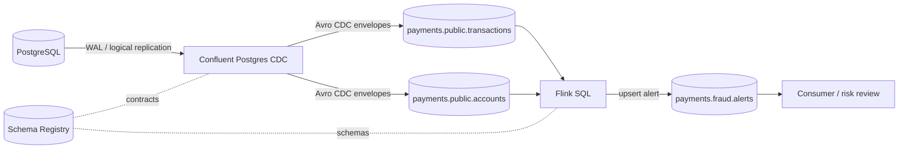

# Arquitetura e decisões

## Por que estas peças

- **CDC em vez de polling:** captura mutações com log de transações e preserva a semântica de insert/update/delete, reduzindo consultas repetidas à origem.
- **Avro + Schema Registry:** contratos evolutivos verificáveis e payloads tipados; os dados publicados não carregam PAN/CVV.
- **Flink SQL:** expressa agregações temporais e enriquecimento com SQL, e pode manter estado/checkpoints para recuperação.
- **Chave estável e sink upsert:** atualizações de janelas podem corrigir o alerta enquanto a janela está ativa; consumidores devem ser idempotentes.
- **Identidades separadas:** o conector escreve eventos CDC, Flink lê fontes e escreve alertas, consumidor lê alertas. Revise ACLs efetivas e adicione permissões mínimas exigidas pelo runtime.

Este desenho é um laboratório. Em produção, separar ambientes, definir SLOs, rotação de segredo, retenção, DLQ/replay, disaster recovery, controles de acesso organizacionais e avaliação quantitativa da regra antes de decisões financeiras.
